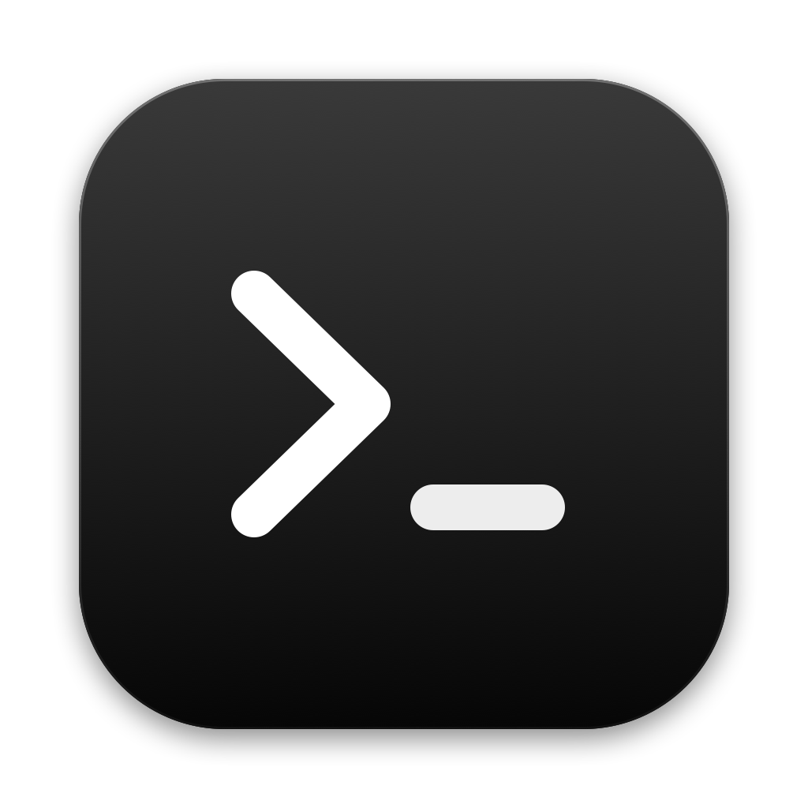

<p align="center">
  
</p>

<h1 align="center">Deck</h1>

<p align="center">
  <strong>A workspace for coding with agents.</strong><br>
  Your terminals, a browser and your coding agents in one native Mac window.
</p>

<p align="center">
  
  
  
</p>

---

Deck puts the things you use all day while working with AI agents side by side. Talk to Claude Code, Codex, Gemini, Grok or OpenCode in a chat. Run any agent's own interface in a real terminal, including Cursor Agent, Amp and Aider. Preview your app in a browser right next to them. Hand an agent a task on its own branch, and review and merge its work when it's done, without leaving the window.

Agents can drive Deck too. From any chat or terminal they can open terminals, start your dev server, open pages and read what's on screen, so "start the app and check the page" just works.

## Features

### Chat with any agent

- **One window, every agent.** Chat with Claude Code, Codex, Gemini CLI, Grok and OpenCode, whichever you have installed, and switch agents in the middle of a thread. Cursor Agent, Amp and Aider run in their own terminals.
- **A control chat** pinned at the top, always there. It can run Deck for you: open tabs, split panes, start servers, open pages.
- **Threads you can read at a glance.** Work folds into a short summary ("Worked for 4s · Ran 2 commands") that opens into every step: the commands run and their output, the files read and edited, with diffs.
- **Approvals where you are typing.** When an agent asks to run a command or edit a file, the request appears above the composer. Answer with a click or ↑↓⏎, or just type what it should do instead. Questions from the agent show their options the same way.
- **Choose how much it may do:** Ask first, Accept edits, or Full access, per thread.
- **Talk while it works.** Messages you send mid-turn reach the agent as soon as its current step finishes. ⌘⏎ sends one right away. Esc stops the turn.
- **Prompt rewriting.** A quick Claude run (Haiku by default) turns what you typed or dictated into a clear, complete prompt, using the thread's task and the agent's last reply to work out what "it" and "that" mean. ⏎ rewrites and sends, ⌃O rewrites into the box without sending, ⌃Z brings back your own words. Short replies, `/` commands and `!` commands go as typed. In Settings you can have it show the rewrite first, pick the model, or turn it off.
- **Turns that fail come back by themselves.** On an API or network error Deck says "continue" after 5s, 10s, 20s… up to five minutes, eight tries; a usage limit waits until it resets; a login or billing problem is shown to you instead. Claude Code stuck in its own retry wait in a terminal gets the same nudge.
- **Attach anything.** Paste a screenshot, drop files in, or `@` a file from the project.
- **Undo a turn.** Every message you send in a git project saves the files as they were, out of your branch's way. Right-click your message to go back to before it, files and chat, or to edit it and go on from there.
- **Select and copy** any part of a conversation, across replies, lists, tables and code.
- **Threads last.** Transcripts, drafts and attachments survive a restart, and Claude resumes its own session.

### Tasks: agents on their own branch

- **Start a task from ⌘K.** Describe what you want ("add dark mode to settings") and pick *Start a task*. Deck makes a fresh branch and a separate checkout for it, then starts an agent working on it there.
- **Run several at once.** Each task has its own folder and branch, so agents never step on each other or on the checkout you're working in.
- **Agents can hand out tasks too.** An agent working on a big job can split it into sub-tasks, each with its own agent on its own branch. Deck tells it when each one finishes, so it can review the changes and merge them. Ask the control chat to "split this into tasks" and watch them run in parallel.
- **Watch them in the sidebar.** Each task shows what its agent is doing right now, or how many files and lines it has changed.
- **Preview it running.** Preview starts the task's dev server from its own checkout on a port of its own and opens the page beside the review.
- **Review, then decide.** The review shows every change file by file. Then:
  - **Merge** squashes it into your branch as one commit.
  - **Open PR** pushes the branch and opens a pull request.
  - **Discard** throws it away.
  - A terminal opens in the task's folder whenever you want to run the tests yourself.

### Terminals

- **Fast and faithful.** True colour, wide characters and emoji, mouse support for TUIs, IME input, smooth scrolling, find in scrollback.
- **Made for agent CLIs.** Paste a screenshot or drop files and their paths go in, so Claude Code and Codex attach them. ⌘-click a link to open it beside the terminal.
- **Knows what's running.** Tabs are named after the program's own title (Claude Code's current task, `vim file.rs`) and the project folder they're in.
- **Your choice of look.** Font, size, line height, cursor, and six colour schemes, or one that matches the window.

### Browser

- **A real browser beside your code.** Search or type an address, with suggestions from your history and your search engine (Google by default).
- **A new tab page** with the sites you visit most and the dev servers running in your terminals.
- **Find in page, downloads, Web Inspector,** two-finger swipe back and forward, ⌘-click to open in a new tab.
- **Pages follow your theme,** in dark or light.

### Knows when an agent needs you

- **A "Needs you" badge** on the agent's tab and a count on the Dock icon when it asks for permission or a question.
- **macOS notifications** when you're looking elsewhere, for questions and for long jobs that finish. Click one to jump straight to that agent.
- **Live status.** Each agent's icon turns while it works, and its row says what it's doing ("Running cargo test", "Editing src/main.rs").

### A workspace that stays out of the way

- **⌘K command palette:** jump to any tab, action, snippet, file or recent page from one box.
- **Snippets** for the messages you send again and again (type `;review` and a space in a chat to put one in; a project can share its own in `.deck/snippets.json`) ("review my changes", "run the tests and fix what fails"). ⌘; lists them, and the one you pick goes into the chat composer or the terminal you are in, ready to add to and send. Save as Snippet keeps what you've typed, or a terminal selection; `{clipboard}` in a snippet puts in what you copied. Edit them in Settings › Snippets.
- **⌘N new tab page:** a terminal, a browser, or any agent, as a chat or in its own terminal.
- **Splits** you can drag to resize, with the focused pane clearly marked.
- **An inspector** for the focused pane: its processes, listening ports, project files and git status.
- **Comes back as you left it.** Tabs, splits and focus are restored after a restart, and agents in terminals resume their conversation.
- **Themes for the whole window:** System, Black, Graphite, Midnight and Light.
- **Settings** you can search, applied as you change them.
- **Your default terminal,** if you like: shell scripts, `.command` files and `ssh:` links open in Deck.
- **Lock** (⇧⌘L) hides everything until Touch ID or your password; your terminals and agents keep running.
- **Updates** arrive by themselves and install on restart.
- **Right-click menus** everywhere, and one zoom (⌘+ / ⌘−) for everything.

## Getting started

Deck runs on macOS 13 or later.

```sh
git clone https://github.com/broisnischal/deck.git
cd deck
scripts/install.sh
```

This installs **Deck.app** into `/Applications` and the `deck` command into `~/.local/bin`. Open Deck from Launchpad or Spotlight.

To sell Deck, build it against an account server so it asks people to sign in and subscribe: `backend/` has one, with its own README.

Deck works with whichever agent CLIs you already have on your `PATH`: `claude`, `codex`, `gemini`, `grok`, `opencode`, `cursor-agent`, `amp`, `aider`. Run `deck doctor` to see which ones it found.

> For notifications from Claude Code running in a terminal, set `"preferredNotifChannel": "iterm2"` in `~/.claude/settings.json`. Deck understands that notification style.

## Keyboard shortcuts

| Shortcut | Does |
| --- | --- |
| ⌘K | Command palette |
| ⌘; | Insert a snippet |
| ⇧⌘L | Lock Deck |
| ⌘N | New tab page |
| ⌘T | New terminal |
| ⇧⌘N | New chat |
| ⌘L | Browser address bar |
| ⇧⌘T | New browser tab |
| ⌘D / ⇧⌘D | Split right / down |
| ⌘W | Close pane |
| ⌘1 … ⌘9 | Go to tab (⌘9 is the last) |
| ⇧⌘] / ⇧⌘[ | Next / previous tab |
| ⌘] / ⌘[ | Next / previous pane |
| ⌘F, ⌘G / ⇧⌘G | Find, next / previous |
| ⇧⌘K | Clear terminal |
| ⌘B / ⌘I | Sidebar / inspector |
| ⌘+ / ⌘− / ⌘0 | Zoom in / out / actual size |
| ⌘, | Settings |

## Let agents drive Deck

Every terminal and chat in Deck can use the `deck` command, so an agent (or you) can work the window from a shell:

```sh
deck pane list                          # what's open right now
deck pane split --cmd 'npm run dev'     # a server in a new terminal beside this one
deck open http://localhost:3000         # the page, in Deck's browser, beside you
deck pane read --pane 3                 # read a terminal's screen
deck pane send --pane 5 'run the tests' # message another agent's chat
deck browser eval --pane 4 'document.title'

deck task new 'add a dark mode toggle to settings'   # a sub-agent on its own branch
deck task list                                       # what every task is doing
deck task wait --task add-a-dark-mode                # until its agent is done
deck task diff --task add-a-dark-mode                # what it changed
deck task merge --task add-a-dark-mode               # squash it into your branch
```

Output is JSON. Run `deck` with no arguments for everything it can do.

Agents in Deck's chats also get all of this as tools of their own through MCP (`deck mcp`), including a look at the window itself.

## Releasing

```sh
scripts/release.sh             # dist/Deck-<version>.dmg and .zip, for Apple silicon and Intel
scripts/release.sh --publish   # and put them on GitHub as release v<version>
```

The disk image is what the website's download button gives people. The zip is what the in-app updater swaps in. Both find the newest release on their own, through the backend's `/v1/releases/latest` (and `https://deck.stroke.click/download/mac` always downloads the newest disk image).

Other Macs only open Deck when it is signed with a Developer ID certificate and notarized by Apple. That takes the Apple Developer Program and a one-time setup, described at the top of `scripts/release.sh`. Until it's done the script still builds, signs ad hoc for your own Mac, and refuses to publish. Raise `version` in `Cargo.toml` for each release.

## License

MIT
